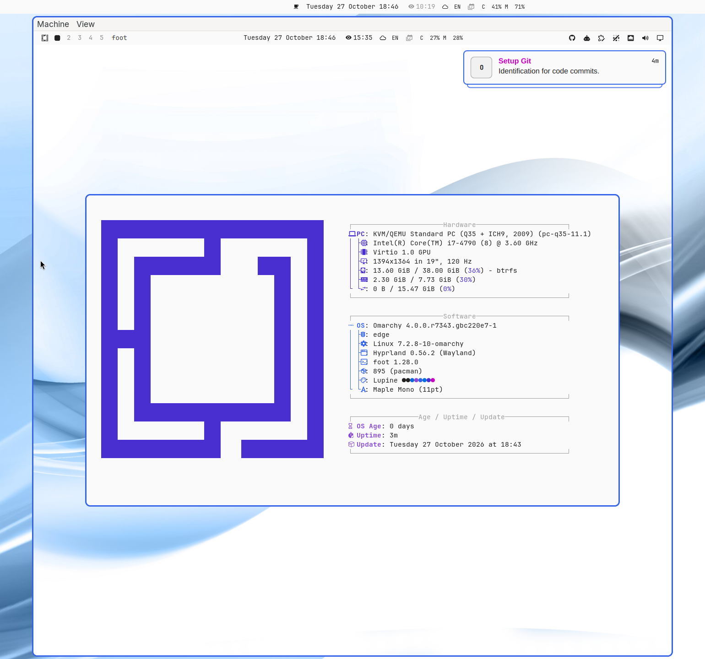

# Omarchy Dev

Run stock [Omarchy](https://omarchy.org) or a feature checkout in a disposable VM. A shared installed base lets test runs skip installation.

<p align="center">
  <a href="assets/omarchy-dev-vm-cropped.png">
    
  </a>
</p>

## Requirements

Use an x86_64 Omarchy host with **mise 2026.10.19 or newer**. At least 20 GiB of free space is recommended.

`mise setup` installs the required host packages from [mise.toml](mise.toml), including QEMU and UEFI firmware. Initial setup needs network access.

## Quick start

Clone this repository, `cd` into it, and run:

```bash
mise trust
mise setup
mise health
mise worktree add my-feature
mise test my-feature
```

Setup clones Omarchy's `quattro` branch and the ISO test repository, downloads the latest edge ISO, and prepares its base. For a stable base, use `mise setup --channel stable`.

The last command opens your feature desktop. Interactive VMs stay running after the command returns. Shut down the guest before starting another run.

## Work on a feature

Edit and commit in `worktrees/my-feature/`. New worktrees use branch `feature/<name>` and start from `quattro`. An optional final argument to `add` selects another branch or commit.

Use `mise worktree list` or `mise worktree remove my-feature` to manage host checkouts.

Feature runs use a snapshot of the checkout, including uncommitted files and deletions. The desktop and acceptance tests use that snapshot. Re-run after host edits. Guest edits are not copied back.

Pending migrations from the activated checkout run in the guest before the desktop is ready or acceptance tests start. Completed migrations keep their existing markers. A failed migration stops the run.

The output reports when migrations are skipped for a stock base, when no migrations are pending, and when pending migrations complete.

## Test a pull request

After setup, run these commands from the workspace root. Replace `123` with the Omarchy PR number:

```bash
git -C omarchy fetch origin refs/pull/123/head:refs/remotes/origin/pr-123
mise worktree add pr-123 refs/remotes/origin/pr-123
mise test pr-123
```

The checkout is `worktrees/pr-123/`, on branch `feature/pr-123`. This tests the PR's current head commit. Use a fresh worktree name because `worktree add` reuses an existing `feature/<name>` branch. To test a later PR revision, fetch again and create a fresh name such as `pr-123-v2` from the updated reference.

To use your host settings, run `mise test --host-config pr-123`. For automated checks without a window or keyboard capture, run:

```bash
mise test --run-tests --ssh --no-grab-kbd pr-123
```

Shut down an interactive guest before starting another run. Each run applies pending migrations inside its disposable overlay. PR changes to installation or package-owned files still need those installation or packaging steps exercised in the guest.

## Run a VM

Run `mise test` for stock Omarchy or `mise test <tree>` for a worktree name or checkout path. Add these options as needed:

| Option | Effect |
| --- | --- |
| `--run-tests` | Run automated checks, then stop the VM |
| `--host-config` | Copy selected host configuration into an interactive guest |
| `--ssh` | Run without a window; keyboard grab remains enabled |
| `--no-grab-kbd` | Leave the host keyboard ungrabbed |

VMs open a QEMU window and grab the keyboard by default. Press **Left Ctrl + Right Ctrl** to toggle the grab. For headless use without host input capture, add `--ssh --no-grab-kbd`.

Use `mise test --help` for all options.

Pass ISO harness options after **`-- --`**. Mise consumes the first separator and the wrapper consumes the second:

```bash
mise test --run-tests my-feature -- -- --keep-running
mise test --ssh --no-grab-kbd -- -- --memory 4096
```

Each run uses a fresh disk overlay and leaves the base disk unchanged.

### Copy host configuration

`--host-config` copies `omarchy`, `hypr`, `alacritty`, `ghostty`, `kitty`, and `foot` from host `~/.config`. Override the list with `OMARCHY_DEV_HOST_CONFIG_DIRS`. Quattro shell/bar settings and plugins live under `~/.config/omarchy` (`shell.json`, `plugins/`, themes). Retired dirs such as `walker` and `waybar` are not in the default list.

The copy also includes saved widget preferences from `~/.local/state/omarchy/settings`. Worktree runs migrate the copied settings first. The guest then applies the host theme from `~/.local/state/omarchy/current/theme.name`, restores the selected background using a guest-local copy of its image or video, and restarts the shell so the configuration and plugins take effect. Missing optional preferences are skipped; a failed transfer, migration, theme application, background restoration, or shell restart fails the run.

The copy skips `hypr/monitors.conf` and `hypr/monitors.lua`, applies only to that run, and is ignored with `--run-tests`.

## Select or rebuild the base

```bash
mise rebase list      # List available remote and local ISOs
mise rebase stable    # Build and select a base from the latest stable ISO
mise rebase status   # Inspect the selected ISO and base
```

Targets are `edge`, `stable`, `rc`, a listed version or ISO filename, or a local ISO path. Channels select the newest available image. With no target, `mise rebase` opens a picker using `gum`.

Rebase reinstalls and selects the chosen base. Setup creates a missing base or reuses a verified one. Existing disks without valid `base.complete` evidence require an explicit rebase, including older bases. Keep selected ISOs at their paths. Moving or replacing one can require a rebuild.

A filesystem device-number change after a remount does not invalidate completion evidence. The ISO path, file inodes, sizes, and timestamps must still match.

## Setup options

Setup accepts `--no-packages`, `--no-base`, and `--no-iso` to skip those steps. With `--no-iso`, base preparation uses an existing local ISO. Combine `--no-iso --no-base` for checkouts only. Use `mise setup --help` for details.

## Files and recovery

| Path | Contents |
| --- | --- |
| `omarchy/` | Base source checkout and Git worktree hub |
| `worktrees/<name>/` | Feature checkouts |
| `omarchy-iso/release/` | Downloaded ISOs |
| `omarchy-iso/test-runs/` | Base images, run disks, logs, and `CURRENT` ISO selection |

Nested checkouts and VM files are Git-ignored. Keep checkouts here as real directories.

`mise health` checks tools and artifacts. `mise rebase status` shows selection. Both are read-only. For a missing selected ISO, rebase to an available target.

Setup and test apply [the harness patch](patches/omarchy-iso-test.patch) when compatible. On conflict, they stop and preserve local contents. Follow the [refresh instructions](AGENTS.md#harness-patch) to reconcile changes. Regenerating from an unmodified harness does not repair a conflict.

## Check the wrappers

```bash
python -m unittest discover -s tests -v
```

These checks require Python 3 and setup's host tools. They use temporary repositories and small qcow2 files without booting a VM. Harness cases are skipped without a local `omarchy-iso` checkout. Use `mise test --run-tests [tree]` for live guest checks.

## License

[MIT](LICENSE).
